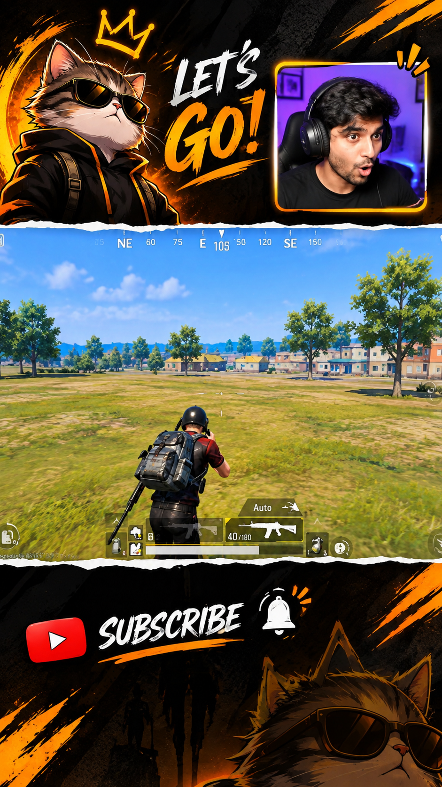

# Landscape gameplay layout: design brief

The brief and reference for the **reel** layout: landscape (16:9) gameplay kept whole in the
middle of a branded 9:16 frame. To see how the skill builds it and how to edit it, read
[the README](../README.md#landscape-gameplay-layout-reel).

**Change since this brief (2026-11-24):** leave out the subscribe banner (the red play button,
SUBSCRIBE and the bell) until you ask for it. It's built, but off: `"reel_subscribe": true` in
settings.json turns it on.

---

# Create an Instagram Gaming Reel Layout (9:16)

I want you to create a professional, reusable Instagram Reels gaming video template with the following exact design and specifications.

## 1. Video dimensions
- Canvas: 1080 × 1920 pixels.
- Aspect ratio: 9:16 (Instagram Reels).
- Output: High-quality MP4, 30 or 60 FPS.
- Keep all important elements within Instagram's safe viewing area.

## 2. Main gameplay section (MOST IMPORTANT)
- The gameplay video must remain in its original landscape 16:9 aspect ratio.
- Position it horizontally in the exact centre of the vertical canvas.
- Do NOT crop, stretch, zoom, or distort the gameplay.
- Preserve the complete original gameplay frame.
- For a 1080px-wide canvas, the gameplay should be approximately 1080 × 608 pixels.
- Add subtle torn-paper edges or a stylish orange border around the gameplay.

## 3. Top section – Branding and facecam

Create a black and dark-textured background with an aggressive gaming aesthetic.

**Left side:**
- Use my attached cat mascot logo.
- Preserve the original logo's appearance, sunglasses, crown, black hoodie and orange/yellow theme.
- Position it prominently on the left.
- Add orange glowing brush strokes and circular accents.
- Add bold graffiti text: "LET'S GO!"

**Right side:**
- Create a rectangular streamer facecam frame.
- Position it in the top-right corner.
- Use my actual facecam footage if provided.
- Add a glowing orange/yellow border.
- Keep the face clearly visible.
- Use subtle animated highlights around the frame.

## 4. Bottom section – Subscribe banner

Use the same black, orange and yellow gaming theme.

Include:
- Red YouTube play icon.
- Large white graffiti-style "SUBSCRIBE" text.
- White notification bell icon.
- Orange brush strokes and claw-mark graphics.
- A faint, oversized version of my cat mascot in the bottom-right background.

## 5. Overall visual style
The design should look like a professional gaming creator's branding.

Color palette:
- Black: primary background.
- Orange: #FF7900.
- Golden yellow: #FFB000.
- White: typography.
- Dark grey: secondary textures.

Visual effects:
- Neon orange glow.
- Grunge textures.
- Graffiti typography.
- Torn-paper dividers.
- Gaming-inspired brush strokes.
- Subtle animations and transitions.

Avoid making it look cluttered or childish.

## 6. Video composition

The final vertical composition should follow this structure:

TOP (approximately 25%)
- Cat mascot logo on the left.
- "LET'S GO!" branding.
- Streamer facecam on the right.

MIDDLE (approximately 32%)
- Original landscape gameplay.
- Full 16:9 aspect ratio.
- Horizontally centred.
- No cropping or distortion.

BOTTOM (approximately 43%)
- Subscribe banner.
- YouTube icon and notification bell.
- Cat mascot watermark.
- Gaming-themed graphics.

Adjust the exact spacing to make the composition visually balanced.

## 7. Technical requirements
- Make the template reusable for different gameplay videos.
- Allow me to replace gameplay footage without changing the design.
- Allow me to replace facecam footage independently.
- Keep the logo as a separate asset.
- Keep text, borders, background and graphics independently editable.
- Ensure the final exported video has no black unintended gaps.
- Maintain the original gameplay aspect ratio at all times.

## 8. Final objective

Recreate the attached reference design as closely as possible.

The gameplay must always remain the main central horizontal element. The facecam and my cat mascot should provide branding without covering the gameplay.

Do not invent a different layout or redesign the concept. Prioritize matching the reference composition.
